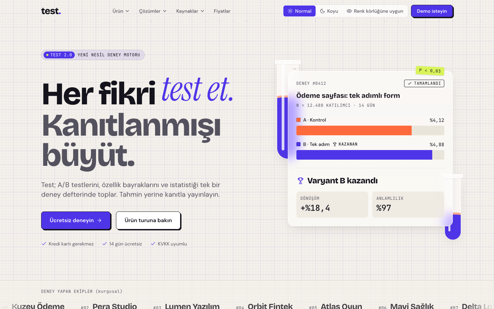
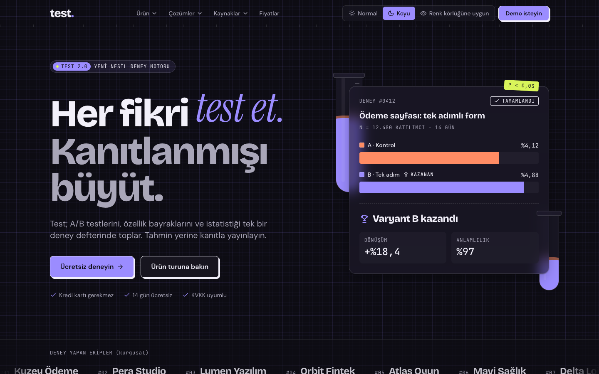
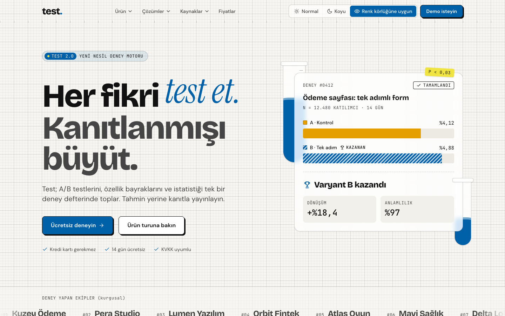
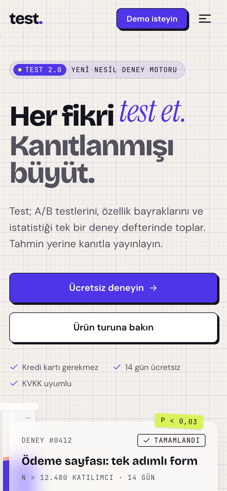
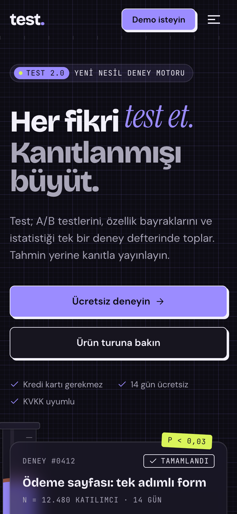
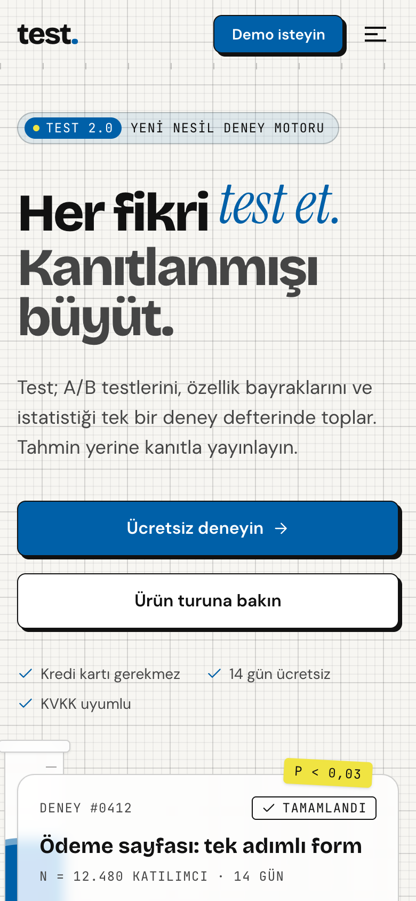

# colorblind-friendly-saas-landing

**Test** — renk körlüğüne uygun modu olan bir SaaS landing page (Next.js).

**"Her fikri _test et._ Kanıtlanmışı büyüt."**

Kurgusal bir deney platformu (A/B testleri, özellik bayrakları) için hazırlanmış landing page. Tasarım sistemi doğrudan kodda kuruldu; menüler ve bazı bölüm düzenleri ayrı bir Figma taslağından uyarlandı. Sayfa yayınlanmıyor; yerelde çalışan bir portfolyo projesi.

| Normal                                           | Koyu                                         | Renk körlüğüne uygun                                               |
| ------------------------------------------------ | -------------------------------------------- | ------------------------------------------------------------------ |
|  |  |  |
|      |      |      |

Her mod URL ile de açılabilir: `/?theme=normal`, `/?theme=dark`, `/?theme=color-safe` (yalnızca önizleme, kaydedilmez).

## Konsept: laboratuvar deney defteri

| Öğe              | Uygulama                                                                       |
| ---------------- | ------------------------------------------------------------------------------ |
| Milimetrik kâğıt | Gövde arka planı: 8 px ince, 40 px kalın çizgi (`graph-paper` yardımcı sınıfı) |
| Laboratuvar camı | Cam efekti (`glass`): kartlar, sonuç kartı, deney tüpleri                      |
| Deney etiketleri | JetBrains Mono, büyük harf (`mono-label`): "DENEY #0412", "N = 12.480"         |
| Ölçüm cetveli    | Bölüm ayraçları, kaydırma ilerlemesi ve "Nasıl çalışır" çizgisi (`ruler`)      |
| El yazısı hissi  | Başlıktaki tek vurgu kelimesi Instrument Serif italik (`<Em>`)                 |
| Sıvı             | Renk lekeleri yalnızca cam tüplerin içinde, dalgalanan sıvı olarak (`LabTube`) |

Kaçınılan şablon kalıpları: mor-pembe gradyan başlık, ortalanmış hero + dashboard maketi, eşit kartlı bento ızgara, tek yazı tipi, dekoratif blob.

## Tasarım sistemi

**Tipografi** (`next/font`, `latin` + `latin-ext`): Bricolage Grotesque ExtraBold (başlık) · Instrument Serif İtalik (vurgu) · DM Sans (metin) · JetBrains Mono (etiket).

**Yerleşim:** 12 kolon, en fazla 1200 px. Asimetrik hero (7 + 5 kolon). Kırılımlar 640 / 768 / 1024 / 1280.

**Renk token'ları** (`src/app/globals.css`). Bileşenler yalnızca semantik token kullanır, bileşenlerde renk koşulu yoktur. Mod değişince `<html data-theme>` üzerindeki değişkenler değişir. Token ve sınıf adları İngilizcedir (`--surface` → `bg-surface`); tabloda Türkçe karşılıkları da var.

| Token (TR karşılığı)        | Normal        | Koyu          | Renk körlüğüne uygun |
| --------------------------- | ------------- | ------------- | -------------------- |
| `canvas` (zemin)            | `#F4F1EA`     | `#0D0C13`     | `#F7F6F2`            |
| `surface` (yüzey)           | `#FFFFFF`     | `#17151F`     | `#FFFFFF`            |
| `surface-2` (yüzey-2)       | `#EAE5DA`     | `#211E2C`     | `#ECEAE3`            |
| `ink` (metin)               | `#15131C`     | `#F2F0FA`     | `#111111`            |
| `muted` (soluk)             | `#55525F`     | `#A9A6B8`     | `#454545`            |
| `line` (çizgi)              | `#15131C` %12 | `#FFFFFF` %12 | `#111111` %22        |
| `brand` (marka)             | `#4F35E8`     | `#9B8CFF`     | `#0060A8`            |
| `on-brand` (marka üstü)     | `#FFFFFF`     | `#0D0C13`     | `#FFFFFF`            |
| `accent` (vurgu)            | `#FF6A3D`     | `#FF8C64`     | `#E69F00`            |
| `highlight` (parlak)        | `#D9F45A`     | `#D9F45A`     | `#F0E442`            |
| `glass` (cam)               | `#FFFFFF` %55 | `#1E1B2A` %60 | `#FFFFFF` %82        |
| `glass-border` (cam kenarı) | `#FFFFFF` %95 | `#FFFFFF` %14 | `#111111` %20        |

Kurallar: `accent` ve `highlight` yalnızca dekor ve yüzey içindir, metin rengi olmaz. `highlight` üzerindeki metin `on-highlight` kullanır. Yalnızca dekor için türetilmiş ek token'lar: `liquid-*` (tüp sıvısı), `ring-*` (dönen çerçeve), `pattern-b` (B serisi deseni), `grid-*`, `shadow-soft`, `glass-highlight`.

## Görünüm modu: Normal · Koyu · Renk körlüğüne uygun

- Tek seçici: `fieldset` + `legend` ("Görünüm modu") içinde yerel radyo düğmeleri. Ok tuşlarıyla gezilir, her seçenekte ikon + metin var. Masaüstünde header'da, mobilde menünün içinde.
- İlk ziyarette `prefers-color-scheme` tercihine göre Normal ya da Koyu seçilir. Seçim `localStorage` içinde (`test-theme`) saklanır.
- `<head>` içindeki betik (`lib/theme-script.ts`) modu ilk boyamadan önce uygular, bu yüzden yanıp sönme olmaz.
- Geçiş View Transitions API ile tıklanan noktadan dairesel açılır. Hareketi azalt tercihinde animasyon yoktur.

**Renk körlüğüne uygun mod**, renk körlüğü olan kullanıcılar düşünülerek hazırlandı. Palet, Okabe-Ito paletinden (mavi / turuncu / sarı) türetildi ve kırmızı-yeşil ayrımına hiç dayanmaz. Bu modda:

- gradyanlar düz renge iner (token'larla: `--liquid-2: var(--liquid-1)`),
- grafiklerde A serisi düz, B serisi taralı desenle ayrılır (`.series-b` → `--pattern-b`),
- cam daha opak olur ve kenarı belirginleşir.

Kazanan, başarı ve hata gibi durumlar **her modda** ikon + metinle gösterilir ("Varyant B kazandı", "Gönderilemedi: …").

## Efektler

Laboratuvar camı kartlar · kaydırınca beliren içerik · count-up sayaçlar · başlıkta dönen kelimeler · durdur/başlat düğmeli kayan şeritler (WCAG 2.2.2) · imleci takip eden ışık · öne çıkan planda dönen çerçeve · büyüyen A/B grafik çubukları · cetvel görünümlü kaydırma ilerlemesi · SSS akordeonu · fiyat geçişinde "pop" · dairesel mod geçişi · tüplerde dalgalanan sıvı.

Animasyonlar yalnızca `transform` ve `opacity` kullanır. Tek istisna dönen çerçevedeki `--angle` özelliği. Hepsi `prefers-reduced-motion` tercihine uyar; bu tercihte kayan şeritler elle kaydırılabilir listeye dönüşür.

## Figma ile birleştirme

Ayrı bir Figma taslağındaki yapı, deney defteri görsel diliyle birleştirildi. Renkler ve yazı tipleri her yerde projedeki token'lardan gelir.

- **Mobil menü:** Başlıklı ("Keşfedin") kart panel, kapatma düğmesi, açıklamalı öğeler, aktif bölüm vurgusu.
- **Masaüstü mega menü:** Ürün / Çözümler / Kaynaklar düğmeleri ve üç sütunlu panel. Düğmeler `aria-expanded` kullanır, açan sütun odak alır, Escape ve dışarı tıklama paneli kapatır.
- **Yeni bölümler:** Entegrasyonlar ("Sevdiğiniz araçlar, aynı masada.") ve deney senaryoları. Senaryolar kaydırılarak ve oklarla gezilir.
- **Düzen:** "Nasıl çalışır" tam genişlikte, marka renginin açık tonunda bir bant içinde. SSS iki sütunlu, CTA marka renkli blok, footer Ürün / Keşfedin / İletişim sütunlu. Planlar Başlangıç / Büyüme / Ölçek, hero rozeti hap biçiminde.
- **Bilerek alınmayanlar:** Ortalanmış hero + dashboard maketi, eşit üç kart ve tek yazı tipi (Inter). Bunlar şablon görünümünden kaçınma kurallarıyla çelişiyor.

## Bölümler

Header (mega menü) → Hero (deney sonuç kartı) → Güven şeridi → Rakamlar → 01 Özellikler → 02 Ürün turu (ARIA sekmeleri) → 03 Nasıl çalışır → Entegrasyonlar → 04 Senaryolar → 05 Fiyatlar → 06 Gözlemler (_kurgusal_) → 07 SSS → CTA → 08 İletişim formu → Footer

## Teknoloji

Next.js 16 (App Router) · TypeScript · Tailwind CSS v4 · React Hook Form + Zod (istemci ve sunucu aynı şema) · Vitest + React Testing Library · ESLint + Prettier · Lighthouse CI. İkon ve animasyonlar ek kütüphane olmadan yazıldı.

## Kurulum

Node **≥ 20.19** gerekir (`.nvmrc`: 22).

```bash
nvm use
npm install
npm run dev          # http://localhost:3000
```

| Komut                           | Açıklama                                                             |
| ------------------------------- | -------------------------------------------------------------------- |
| `npm run lint`                  | ESLint                                                               |
| `npm run typecheck`             | `next typegen` + `tsc --noEmit`                                      |
| `npm test`                      | Vitest: form, akordeon, mobil menü, mega menü ve mod seçici testleri |
| `npm run build && npm run lhci` | Lighthouse CI, üç modu ayrı ayrı ölçer                               |

**Form hata durumunu denemek için** e-posta adresini `@fail.test` ile bitirin. Route handler 503 döner.

## Lighthouse

Lighthouse CI üç modu (`?theme=normal`, `?theme=dark`, `?theme=color-safe`) mobil ayarlarla ayrı ayrı ölçer. Eşiğin altında build başarısız olur.

| Kategori       | Hedef | CI eşiği | Yerel ölçüm    |
| -------------- | ----- | -------- | -------------- |
| Performance    | ≥ 95  | 85       | 87–93          |
| Accessibility  | 100   | 100      | 100 (üç modda) |
| Best Practices | 100   | 100      | 100 (üç modda) |
| SEO            | 100   | 100      | 100 (üç modda) |

Performance hedefi henüz tutmuyor. Gerçek tarayıcıda LCP yaklaşık 0,3 sn, ancak Lighthouse'un yavaş 4G simülasyonunda 3,2–3,6 sn çıkıyor ve skoru düşüren bu. CI eşiği bu yüzden şimdilik 85; performans iyileştikçe 95'e çekilecek.

## Proje yapısı

```
src/
  app/            layout, page, globals.css (token'lar), api/contact, sitemap, robots, OG görseli
  components/
    layout/       Header, mod seçici, footer, başa dön
    sections/     Sayfa bölümleri, sonuç kartı, özellik görselleri, ürün maketleri
    contact/      İletişim formu
    ui/           Icon, Button, Reveal, CountUp, Accordion, SpotlightCard, LabTube, SectionHeading …
  content/        Tüm metinler ve veriler (landing.ts)
  lib/            Tema deposu (theme.ts), tema betiği, Zod şeması
```

Test kurgusal bir markadır. Ekipler, kişiler, yorumlar ve rakamlar örnek amaçlıdır.
